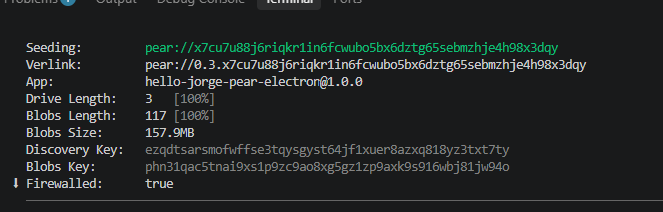

# Tic Tac Toe

A Tic Tac Toe multiplayer game app built on top of the Autopass API.

## Demo

<video src="https://github.com/user-attachments/assets/5a715c66-481c-4914-b820-da69dc0aa75f" controls width="100%"></video>

<a href="https://github.com/user-attachments/assets/5a715c66-481c-4914-b820-da69dc0aa75f" target="_blank" rel="noopener noreferrer">Open the uploaded video in a new tab</a>

[Download the compressed demo video](./assets/tic-tac-toe-demo.mp4).

## Screenshots




## Install from Pear

With the Pear CLI installed, install the staged app using:

```sh
pear install pear://x7cu7u88j6riqkr1in6fcwubo5bx6dztg65sebmzhje4h98x3dqy
```

This app is currently seeded from my machine, so it needs to be online and reachable
while the app downloads. I have not set up an always-on server yet. The seeder currently
reports `Firewalled: true` (see the screenshot above), so peers may not be able to connect
even while my machine is online.

## Playing with two development instances

Open two terminals in the repository. Give each app instance its own storage directory:

```sh
npm start -- --storage /tmp/pear-ttt-player-a --no-updates
```

```sh
npm start -- --storage /tmp/pear-ttt-player-b --no-updates
```

In the first instance, create a game and choose **Share**. Copy the invite payload, then
choose **Join game** in the second instance, paste the payload, and enter the name to use
for that game. The second instance should then list the shared game. Keep both instances
open while they pair and sync. Game changes refresh automatically as notes sync; if an
instance does not receive a change, reload that window to fetch the latest game state.

## AI usage disclosure

AI tools were used extensively during development. I spent more than eight hours
directing the work, evaluating suggestions, and integrating changes. I personally
reviewed and steered approximately 80% of the AI-generated code. The project direction
and implementation decisions were mine, and I take responsibility for the final solution.
I would be happy to walk the interviewers through the code and explain my decisions in
an online interview, helping them assess my understanding directly and make efficient use
of their time.
